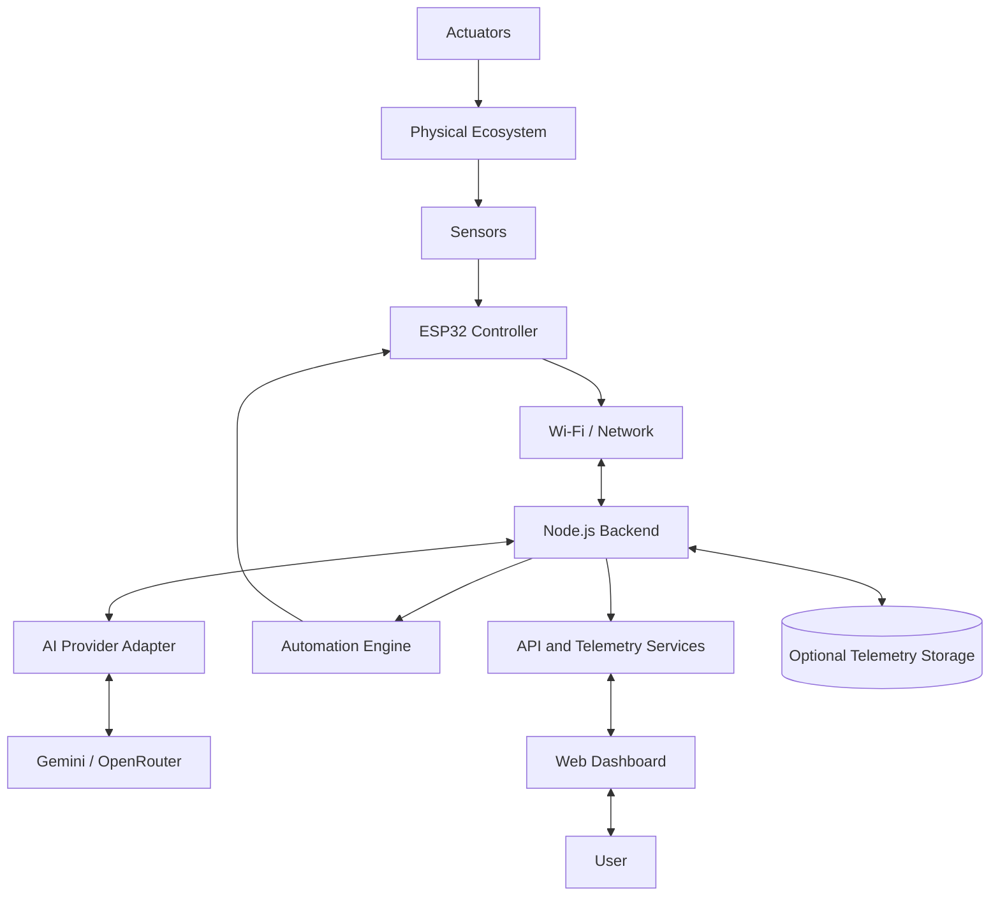
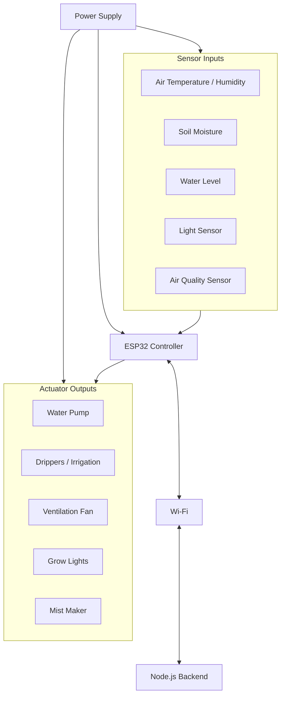
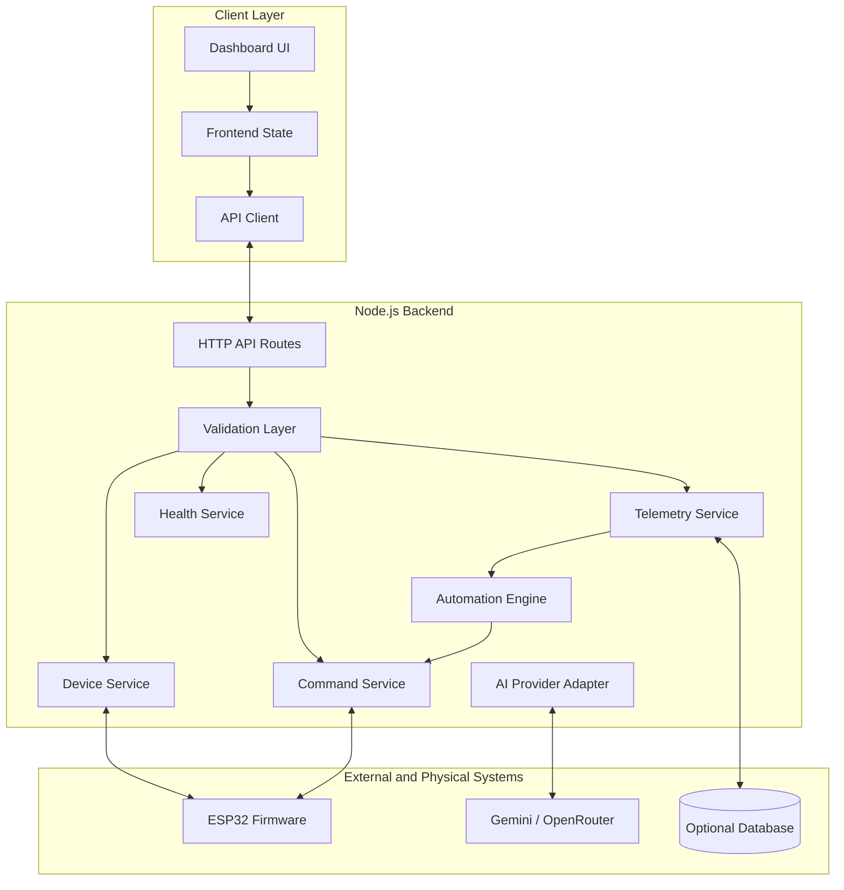
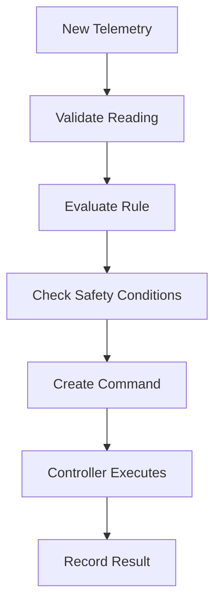
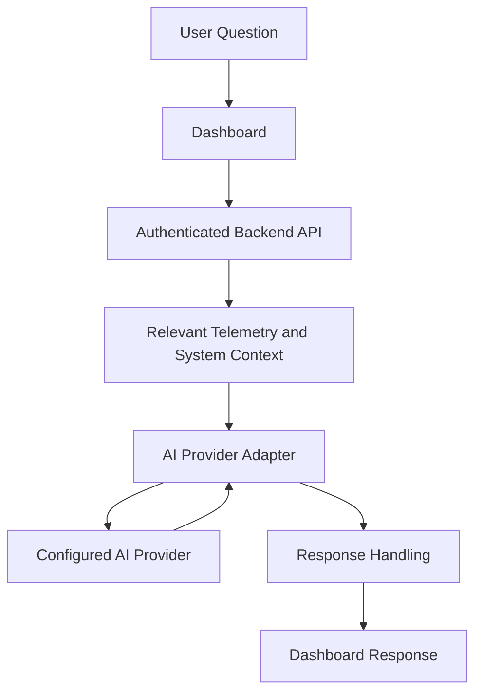

# Ecosystem OS

**An intelligent ecosystem monitoring, automation, and management platform.**

> A modular software and hardware system designed to observe environmental conditions, visualize ecosystem telemetry, automate physical systems, and provide intelligent insights through an integrated dashboard.

**Project status:** Early development / architecture and rebuild  
**Version:** 3.0.0 — initial rebuild  
**Repository:** `Ecosystem-OS`  
**Primary application:** Web dashboard + Node.js backend + embedded hardware  
**Hardware firmware:** Maintained separately from the main software repository

---

## Table of Contents

1. [Project Overview](#1-project-overview)
2. [Vision and Objectives](#2-vision-and-objectives)
3. [Core Features](#3-core-features)
4. [System Architecture](#4-system-architecture)
5. [Hardware Architecture](#5-hardware-architecture)
6. [Software Architecture](#6-software-architecture)
7. [Communication Architecture](#7-communication-architecture)
8. [Telemetry and Data Architecture](#8-telemetry-and-data-architecture)
9. [Automation Architecture](#9-automation-architecture)
10. [AI Architecture: JARVIS](#10-ai-architecture-jarvis)
11. [Frontend Architecture](#11-frontend-architecture)
12. [Backend Architecture](#12-backend-architecture)
13. [Security and Reliability](#13-security-and-reliability)
14. [Repository Structure](#14-repository-structure)
15. [Development Environment](#15-development-environment)
16. [Development Roadmap](#16-development-roadmap)
17. [Testing Strategy](#17-testing-strategy)
18. [Team and Responsibilities](#18-team-and-responsibilities)
19. [Limitations and Design Principles](#19-limitations-and-design-principles)
20. [Contributing](#20-contributing)
21. [License](#21-license)

---

## 1. Project Overview

Ecosystem OS is a modular environmental monitoring and automation platform that connects physical environmental systems to a centralized software interface.

The platform is intended to collect telemetry from sensors, process and organize incoming data, present environmental conditions through a web dashboard, control compatible hardware, and provide AI-assisted interpretation of ecosystem data.

Despite its name, Ecosystem OS is not intended to replace a computer's operating system. It is an ecosystem management platform that provides an operating-system-inspired interface for interacting with environmental hardware and software services.

The architecture separates hardware firmware, backend services, frontend presentation, and AI integrations. This separation allows each subsystem to evolve independently without forcing the entire project to be rewritten whenever one component changes.

### 1.1 The problem

Environmental monitoring systems can become difficult to manage when sensor readings, manual controls, automation rules, and analytical tools are distributed across separate interfaces.

Ecosystem OS aims to bring these functions together through a common system that can:

- Collect environmental data from compatible sensors.
- Present live and historical telemetry.
- Monitor ecosystem conditions and system health.
- Operate compatible pumps, fans, irrigation systems, and lighting.
- Execute configurable automation rules.
- Provide AI-assisted explanations and recommendations.
- Expose system status through a unified dashboard.

### 1.2 The proposed solution

Ecosystem OS combines embedded electronics, a backend service, a browser-based dashboard, and optional AI providers.

The hardware observes the physical environment. The backend coordinates communication, validation, state management, automation, and API access. The frontend provides the human interface. AI services interpret relevant data and generate explanations where configured.

The design is modular, so the system can begin with simulated telemetry and gradually integrate real hardware.

### 1.3 Project status and implementation policy

Ecosystem OS is being rebuilt from a clean repository.

The architecture in this document describes the intended system. It does not claim that every component has already been implemented, tested, or connected to physical hardware.

Individual capabilities become implemented features only after their code exists and their behavior has been verified.

---

## 2. Vision and Objectives

### 2.1 Vision

Build an intelligent, modular ecosystem management platform that connects physical environmental systems with accessible monitoring, automation, and analytical software.

### 2.2 Primary objectives

1. **Unified monitoring:** Present environmental measurements through a centralized dashboard.
2. **Hardware integration:** Support embedded controllers and compatible sensors and actuators.
3. **Intelligent automation:** Enable configurable responses to environmental conditions.
4. **AI-assisted interpretation:** Explain telemetry, identify patterns, and suggest possible actions.
5. **Modularity:** Keep the frontend, backend, firmware, and AI integrations independently maintainable.
6. **Reliability:** Validate telemetry, detect communication failures, and represent unavailable data honestly.
7. **Extensibility:** Make it possible to add sensors, controllers, integrations, and analytical features without redesigning the entire system.
8. **Cost awareness:** Prefer incremental development, reusable components, and affordable hardware where practical.

### 2.3 Design principles

- Separate responsibilities between components.
- Keep hardware firmware outside the main frontend/backend repository.
- Use validated, structured data rather than arbitrary sensor payloads.
- Distinguish real measurements from simulated values.
- Treat AI recommendations separately from deterministic control rules.
- Keep safety-critical actuator behavior independent of cloud AI availability.
- Document architectural decisions and changes.
- Avoid adding infrastructure before the application requires it.

---

## 3. Core Features

The following are planned capabilities, not a claim that they are all currently available.

| Feature                 | Purpose                                               |
| ----------------------- | ----------------------------------------------------- |
| Environmental dashboard | Present sensor measurements and system status         |
| Telemetry interface     | Inspect individual readings and trends                |
| Sensor integration      | Receive measurements from supported hardware          |
| Actuator controls       | Operate compatible physical devices                   |
| Automation engine       | Apply configured rules to validated measurements      |
| JARVIS assistant        | Provide AI-assisted explanations and analysis         |
| Ecosystem health        | Summarize environmental and operational indicators    |
| System health           | Report connectivity, stale data, and component status |
| Historical analytics    | Explore stored measurements and trends                |
| Modular integrations    | Add sensors, AI providers, and communication adapters |

### 3.1 Initial development priorities

The first usable milestone should prioritize:

1. A stable dashboard.
2. Simulated telemetry with explicit simulation indicators.
3. A defined telemetry data model.
4. A functioning Node.js API.
5. Reliable frontend-to-backend communication.
6. Hardware integration interfaces.
7. Basic actuator controls with safety checks.

Advanced analytics, persistent historical storage, and AI-powered automation should follow once the basic data pipeline is reliable.

---

## 4. System Architecture

### 4.1 High-level architecture



This diagram represents the intended logical architecture. Actual network transports, storage technology, and controller interfaces will be selected and verified during implementation.

### 4.2 Architectural layers

**Layer 1: Physical environment**

The ecosystem being monitored, including environmental conditions and the physical equipment used to influence them.

**Layer 2: Hardware and embedded control**

Sensors, actuators, electrical interfaces, and the ESP32 controller. This layer samples measurements, performs local control where necessary, and communicates with the software system.

**Layer 3: Communication**

The network and messaging interfaces used to transport telemetry and control requests.

**Layer 4: Backend services**

The Node.js application responsible for API endpoints, input validation, device state, telemetry processing, automation coordination, and integration management.

**Layer 5: Intelligence and analytics**

Rule evaluation, derived indicators, historical analysis, and optional AI-assisted interpretation.

**Layer 6: User interface**

The browser-based dashboard used to monitor the system, inspect data, configure supported behavior, and issue authorized commands.

### 4.3 Architectural boundaries

The frontend must not communicate directly with private AI credentials or privileged backend resources.

The hardware must not depend on a browser remaining open to maintain essential local safety behavior.

The AI service must not become a mandatory dependency for basic sensor collection or safe actuator operation.

The backend must distinguish the latest received reading from a current, trustworthy measurement.

---

## 5. Hardware Architecture

### 5.1 Hardware overview

The hardware subsystem connects the physical ecosystem to the digital management platform.

An ESP32-class microcontroller is the intended primary controller for network-connected sensing and control. Exact board models, sensor part numbers, electrical ratings, and communication interfaces must be confirmed against the actual hardware inventory before the design is finalized.

### 5.2 Hardware block diagram



The block diagram illustrates potential subsystem connections. It does not specify a final wiring diagram, pin assignment, power budget, or driver circuit.

### 5.3 Controller

**Intended controller:** ESP32 family.

Expected responsibilities include:

- Sampling supported sensors.
- Applying basic measurement validation.
- Maintaining local actuator safety rules.
- Managing connectivity to the backend.
- Reporting telemetry and controller status.
- Receiving authorized control commands.
- Reporting command results and faults.
- Maintaining safe behavior when network communication fails.

Exact firmware framework and board selection remain implementation decisions.

### 5.4 Sensor subsystem

The planned environmental sensor categories include:

| Measurement      | Possible sensor                         | Purpose                                 |
| ---------------- | --------------------------------------- | --------------------------------------- |
| Air temperature  | DHT11, DHT22, or a suitable alternative | Monitor ambient temperature             |
| Air humidity     | DHT11, DHT22, or a suitable alternative | Measure relative humidity               |
| Soil moisture    | Compatible moisture sensor              | Estimate soil moisture                  |
| Water level      | Compatible level sensor                 | Monitor reservoir availability          |
| Light intensity  | Compatible light sensor                 | Estimate available light                |
| Air quality      | Compatible gas or air-quality sensor    | Monitor selected air-quality indicators |
| Soil temperature | Compatible temperature probe            | Measure soil temperature                |

The named components are candidate options from earlier project planning, not a declaration that each one is currently owned, connected, or suitable for the final hardware revision.

#### Sensor integration requirements

Each sensor integration should define:

- A unique sensor identifier.
- Measurement type and units.
- Sampling interval.
- Calibration requirements.
- Valid measurement range.
- Error and disconnection behavior.
- Data freshness rules.
- Hardware interface and pin assignment.

Measurements must not be treated as reliable merely because a numeric value was received.

### 5.5 Actuator subsystem

Potential controlled devices include:

- Water pumps.
- Irrigation drippers or valves.
- Ventilation fans.
- Mist makers.
- LED grow lights.

Actuator switching must use suitable driver circuitry, relay modules, MOSFETs, or other interfaces appropriate to the device's voltage, current, and load characteristics.

High-current loads must not be powered directly from a microcontroller GPIO pin.

#### Actuator control requirements

Each actuator should have:

- A stable device identifier.
- Supported commands and states.
- Electrical and operational limits.
- A command timeout where appropriate.
- A defined safe state.
- Confirmation of the resulting state where possible.
- Fault reporting.
- Manual override behavior.

A command being accepted by the backend does not automatically prove that the physical actuator changed state.

### 5.6 Power architecture

The power subsystem must provide suitable power for the controller, sensors, and actuators.

The design must account for:

- Voltage requirements.
- Peak current demand.
- Startup current for motors and pumps.
- Regulator capacity.
- Grounding and electrical noise.
- Reverse-polarity and short-circuit protection where appropriate.
- Battery protection if a battery is used.
- Separation of logic power and higher-current loads where necessary.

The final power distribution diagram must be produced after the actual components and ratings are confirmed.

### 5.7 Hardware safety

- Use suitable driver circuits for inductive and high-current loads.
- Never assume a failed sensor reading is safe to act upon.
- Define maximum pump or mist operation durations.
- Prevent unsafe repeated commands.
- Provide local shutdown behavior independent of cloud availability.
- Protect exposed electronics from moisture.
- Verify wiring and power requirements before connecting physical loads.

### 5.8 Firmware repository separation

The embedded firmware is maintained separately from the primary Ecosystem OS web application repository.

This separation keeps firmware toolchains, generated build output, board configuration, and embedded dependencies from cluttering the main VS Code workspace.

The software repository communicates with the firmware through defined device communication interfaces rather than depending on the firmware source files being part of the same application tree.

---

## 6. Software Architecture

### 6.1 Software overview

The main software system is intended to consist of four major subsystems:

1. Frontend web application.
2. Node.js backend.
3. Hardware communication integration.
4. AI and analytics integrations.

These components should communicate through explicit interfaces and structured data contracts.

### 6.2 Software architecture diagram



### 6.3 Frontend responsibilities

The frontend is responsible for:

- Rendering the dashboard.
- Displaying sensor measurements.
- Showing data freshness and connection state.
- Presenting device controls.
- Displaying automation status.
- Rendering analytical insights.
- Collecting user input.
- Calling backend APIs.
- Displaying loading, success, and failure states.

The frontend should not independently decide that an actuator is safe to operate. The backend and hardware must enforce the applicable constraints.

### 6.4 Backend responsibilities

The backend is responsible for:

- Exposing documented API endpoints.
- Validating incoming requests.
- Managing normalized telemetry.
- Tracking device connectivity and state.
- Coordinating commands.
- Evaluating automation rules.
- Integrating AI providers.
- Handling failures and timeouts.
- Enforcing access controls.
- Reporting service health.

### 6.5 Hardware integration responsibilities

The hardware integration layer translates between the backend's device model and the actual communication protocol supported by the controller.

It should isolate protocol-specific details so that changing a transport or adding another controller does not require rewriting dashboard components.

### 6.6 AI integration responsibilities

The AI integration layer should expose a consistent internal interface regardless of the configured provider.

Provider-specific API formats, credentials, errors, and response parsing belong inside the integration adapter rather than being scattered across the application.

### 6.7 Data flow

A typical telemetry cycle follows this sequence:

1. A sensor measures an environmental condition.
2. The microcontroller reads and validates the measurement.
3. The controller creates a structured telemetry message.
4. The message is sent to the backend through the configured transport.
5. The backend validates the device identity, payload, units, and timestamp.
6. Accepted data updates the relevant telemetry state.
7. The backend exposes the current state through its API.
8. The frontend retrieves the updated data and renders it.
9. Automation rules may evaluate the new measurement.
10. Optional analytics or AI services may interpret the measurement.

If a reading is rejected, stale, or unavailable, the dashboard must not silently present it as a fresh measurement.

---

## 7. Communication Architecture

### 7.1 Communication paths

Ecosystem OS has several distinct communication paths:

| Path                  | Purpose                                            |
| --------------------- | -------------------------------------------------- |
| Browser → backend     | Dashboard requests and commands                    |
| Controller → backend  | Sensor telemetry and controller status             |
| Backend → controller  | Authorized control commands                        |
| Backend → AI provider | Analysis requests                                  |
| Backend → storage     | Historical telemetry and configuration, if enabled |

### 7.2 Browser communication

HTTP APIs are suitable for initial dashboard operations.

A persistent connection such as WebSocket or Server-Sent Events may be introduced when live updates justify it.

The transport must be documented and consistent with the implemented backend.

### 7.3 Hardware communication

The ESP32 is expected to communicate over a network connection, initially using Wi-Fi where available.

Possible application transports include:

- HTTP-based telemetry and commands.
- MQTT-based messaging.
- A persistent socket connection.

These are alternative implementation options, not a claim that all are currently configured. The initial transport should be chosen based on device requirements and then documented as the canonical protocol.

Bluetooth may be considered for local provisioning or diagnostics if the selected hardware and firmware support it.

### 7.4 Network boundaries

The hardware communication protocol should be independent of the browser's internal implementation.

The frontend should communicate with the backend rather than directly issuing arbitrary network commands to the controller.

Production deployments should use encrypted communication and authenticated device identities wherever supported.

---

## 8. Telemetry and Data Architecture

### 8.1 Telemetry model

Every measurement should include enough metadata to determine what it means, where it originated, and whether it can be trusted.

A proposed telemetry record is:

```json
{
  "deviceId": "esp32-main",
  "sensorId": "air-temperature-01",
  "metric": "air_temperature",
  "value": 25.4,
  "unit": "degC",
  "timestamp": "2026-10-16T12:00:00Z",
  "quality": "valid",
  "source": "hardware"
}
```

This is an illustrative schema. The final schema must be implemented consistently across firmware, backend, and frontend.

### 8.2 Core telemetry fields

- `deviceId`: controller or device identifier.
- `sensorId`: identifier of the measurement source.
- `metric`: normalized measurement name.
- `value`: numeric measurement.
- `unit`: measurement unit.
- `timestamp`: measurement time in a standardized format.
- `quality`: validity or quality classification.
- `source`: distinguishes hardware data from simulation.

Optional fields may include calibration metadata, sequence numbers, firmware version, and diagnostic information.

### 8.3 Data validation

The backend should validate:

- Required fields.
- Data types.
- Allowed measurement names.
- Valid units.
- Plausible measurement ranges.
- Device authorization.
- Timestamp format.
- Duplicate or out-of-order messages where relevant.

Invalid data should produce a controlled error and diagnostic record rather than silently corrupting the system state.

### 8.4 Data freshness

A measurement is not necessarily current simply because it exists in memory.

Each telemetry source should have an expected reporting interval and a freshness threshold.

The dashboard should distinguish states such as:

- Live.
- Delayed.
- Stale.
- Unavailable.
- Invalid.
- Simulated.

Thresholds must be configurable for the actual sensor and reporting interval.

### 8.5 Storage strategy

Historical persistence is optional until a storage technology is selected.

The initial system may use in-memory state during development. A later version can add a database for historical measurements, event records, configuration, and analytics.

The chosen storage system must be documented once it is implemented.

---

## 9. Automation Architecture

### 9.1 Purpose

The automation engine evaluates environmental measurements and configured conditions to determine whether an authorized action should be requested.

Automation must be deterministic, inspectable, and subject to safety limits.

### 9.2 Proposed rule model

A rule may contain:

- Rule identifier.
- Enabled or disabled state.
- Measurement to evaluate.
- Comparison operator.
- Threshold.
- Optional duration or hysteresis.
- Target actuator.
- Requested action.
- Cooldown interval.
- Safety limits.
- Last evaluation and execution result.

### 9.3 Example

An irrigation rule might request watering when a valid soil-moisture measurement falls below a configured threshold.

The rule should not execute if the soil sensor is unavailable, the reservoir is empty, a pump safety limit has been reached, or the controller is disconnected.

The threshold must be calibrated for the actual sensor and ecosystem rather than copied from an arbitrary example.

### 9.4 Automation pipeline



If validation fails, the rule should not act on the invalid reading. If safety checks fail, the command should be rejected or suppressed with an explicit reason.

### 9.5 Safety requirements

- Maximum actuator runtime.
- Cooldown and rate limiting.
- Duplicate-command protection where practical.
- Manual override.
- Sensor freshness requirements.
- Safe behavior during disconnection.
- Command-result tracking.
- Clear separation between a requested action and a confirmed physical state.

AI-generated suggestions must not bypass these checks.

---

## 10. AI Architecture: JARVIS

### 10.1 Purpose

JARVIS is the intended AI-assisted interface for interpreting ecosystem data and helping users understand system behavior.

The name describes the assistant feature, not a separate operating system or an autonomous controller.

### 10.2 Planned capabilities

- Explain current environmental measurements.
- Summarize changes in telemetry.
- Identify potential trends in available data.
- Explain why an automation rule was triggered.
- Suggest possible troubleshooting steps.
- Summarize system health and reported faults.
- Answer questions about the system's documented configuration.

These capabilities depend on the relevant data and integrations being available.

### 10.3 AI architecture



### 10.4 Provider integration

Potential providers include Google Gemini and services accessed through OpenRouter.

Only the configured provider should be used for a particular request unless explicit fallback behavior is implemented.

The provider adapter should manage:

- Authentication.
- Request formatting.
- Context construction.
- Timeouts.
- Rate limits.
- Error normalization.
- Response validation.
- Provider selection.

API keys must remain in server-side environment variables and must never be embedded in public frontend code.

### 10.5 AI limitations

AI output is advisory, not authoritative sensor data.

The assistant must not invent measurements, claim a physical action succeeded without confirmation, or conceal uncertainty when telemetry is missing.

AI output should not directly execute an actuator command without passing through the normal authorization and safety pipeline.

The system should continue providing core monitoring and safe local operation when AI services are unavailable.

---

## 11. Frontend Architecture

### 11.1 Purpose

The frontend provides a single interface for viewing ecosystem data and interacting with supported system services.

The planned visual direction is a dark, green-accented, OS-inspired dashboard.

### 11.2 Main interface modules

**Overview**

Provides a summary of environmental conditions, ecosystem indicators, and active systems.

**Telemetry**

Displays measurements, data freshness, and supported historical views.

**JARVIS**

Provides AI-assisted questions, explanations, and analytical summaries.

**Automation**

Displays configured rules, their status, and recent outcomes.

**Controls**

Exposes authorized controls for compatible actuators.

**Health**

Summarizes system status, measurement quality, and connectivity.

**Insights**

Presents trends and analytical results derived from available data.

**About**

Documents the application, architecture, version, and project information.

These are intended interface modules. Their presence in the architecture does not mean that each is already implemented.

### 11.3 User interface principles

- Keep navigation predictable.
- Make connection status visible.
- Distinguish unavailable data from zero-valued measurements.
- Show confirmation and failure states.
- Avoid presenting simulated values as real hardware readings.
- Provide keyboard-accessible controls.
- Support different screen sizes.
- Preserve clear visual separation between telemetry, analysis, and physical control.

### 11.4 Frontend/backend boundary

The frontend should use a dedicated API client or service layer rather than embedding network requests throughout every UI component.

The UI should render data returned by the backend and report the state of requests accurately.

Hardware safety rules must not exist only in frontend JavaScript.

---

## 12. Backend Architecture

### 12.1 Runtime

The intended backend runtime is Node.js.

The backend should use a modular structure, with each module owning a clear responsibility.

### 12.2 Proposed backend modules

| Module              | Responsibility                               |
| ------------------- | -------------------------------------------- |
| API routes          | Expose documented endpoints                  |
| Validation          | Validate payloads and parameters             |
| Device service      | Manage registered devices and reported state |
| Telemetry service   | Normalize and distribute measurements        |
| Command service     | Authorize and coordinate actuator commands   |
| Automation engine   | Evaluate configured rules                    |
| AI provider adapter | Integrate supported AI providers             |
| Health service      | Report backend and integration status        |
| Storage adapter     | Persist data when a database is configured   |
| Logging             | Record operational events and errors         |

### 12.3 Proposed API surface

The following endpoint names are suggestions for the initial API contract, not existing endpoints.

| Method | Endpoint                 | Purpose                                                     |
| ------ | ------------------------ | ----------------------------------------------------------- |
| `GET`  | `/api/health`            | Backend health                                              |
| `GET`  | `/api/devices`           | List registered devices                                     |
| `GET`  | `/api/devices/:id`       | Retrieve device information                                 |
| `GET`  | `/api/telemetry/latest`  | Retrieve latest accepted measurements                       |
| `GET`  | `/api/telemetry/history` | Retrieve historical measurements when storage exists        |
| `POST` | `/api/telemetry`         | Receive telemetry where this ingestion method is configured |
| `GET`  | `/api/automation/rules`  | List configured automation rules                            |
| `POST` | `/api/automation/rules`  | Create a validated rule                                     |
| `POST` | `/api/commands`          | Submit an authorized device command                         |
| `GET`  | `/api/commands/:id`      | Inspect command status                                      |
| `POST` | `/api/jarvis/ask`        | Submit a question for AI-assisted analysis                  |

Routes should be added only when their corresponding service and validation behavior are implemented.

### 12.4 API design principles

- Use consistent JSON responses.
- Validate all external input.
- Return meaningful HTTP status codes.
- Avoid exposing internal stack traces.
- Use request timeouts and size limits.
- Authenticate privileged operations.
- Apply rate limits where appropriate.
- Keep provider credentials out of API responses.
- Document command status and error semantics.

---

## 13. Security and Reliability

### 13.1 Secrets management

Private credentials belong in environment variables or an appropriate secret-management system.

The repository must not contain real AI API keys, passwords, access tokens, or private deployment credentials.

The `.gitignore` file should exclude `.env` and other sensitive local configuration files.

A `.env.example` file may document required variable names using placeholders only.

### 13.2 Authentication and authorization

Production deployments should authenticate users and devices.

Read-only telemetry access and actuator-control privileges should be distinguishable.

Device identities should be validated before telemetry or commands are accepted.

### 13.3 Network security

- Use HTTPS for production browser-to-backend communication.
- Authenticate hardware connections.
- Protect actuator commands against unauthorized requests.
- Avoid exposing development servers directly to the public internet.
- Restrict cross-origin access to trusted origins.
- Validate network payloads even when the sender is expected to be trusted.

### 13.4 Reliability

The platform should account for:

- Disconnected sensors.
- Network interruptions.
- Backend restarts.
- AI provider outages.
- Invalid or stale measurements.
- Command timeouts.
- Hardware faults.
- Partial system availability.

A failure in one optional subsystem should not unnecessarily disable unrelated monitoring capabilities.

### 13.5 Logging

Operational logs should identify the relevant component, event, timestamp, and outcome.

Logs should avoid exposing credentials or unnecessary personal information.

### 13.6 Deployment

The frontend and backend may be deployed separately or together, depending on hosting requirements.

Any serverless deployment must account for the fact that in-memory state does not reliably persist across invocations and that persistent device connections may require a continuously running service.

The actual deployment platform, persistence model, and device reachability strategy must be selected and tested before being documented as production-ready.

---

## 14. Repository Structure

The main repository contains the web application and backend. ESP32 firmware remains in a separate repository or workspace.

A proposed structure is:

```text
Ecosystem-OS/
├── .github/
│   └── workflows/
│       └── ci.yml
│
├── backend/
│   ├── src/
│   │   ├── api/
│   │   ├── config/
│   │   ├── devices/
│   │   ├── telemetry/
│   │   ├── commands/
│   │   ├── automation/
│   │   ├── ai/
│   │   ├── storage/
│   │   ├── middleware/
│   │   ├── services/
│   │   ├── utils/
│   │   └── server.js
│   ├── tests/
│   └── package.json
│
├── src/
│   ├── assets/
│   │   ├── icons/
│   │   └── images/
│   ├── css/
│   │   ├── style.css
│   │   ├── layout.css
│   │   ├── cards.css
│   │   └── responsive.css
│   ├── js/
│   │   ├── api/
│   │   ├── components/
│   │   ├── services/
│   │   └── state/
│   ├── index.html
│   └── script.js
│
├── docs/
│   ├── architecture/
│   │   ├── system-architecture.md
│   │   ├── hardware-architecture.md
│   │   ├── software-architecture.md
│   │   └── communication-protocol.md
│   ├── api/
│   └── decisions/
│
├── hardware/
│   └── README.md
│
├── .env.example
├── .gitignore
├── README.md
├── package.json
└── vercel.json
```

This is a proposed target structure, not a statement that all listed files already exist.

The `hardware/` directory in the main repository is intended for hardware documentation, diagrams, pin maps, and interface specifications only. The separate ESP32 firmware source should not be copied into this repository.

The exact folder layout may change as implementation progresses, provided the separation of responsibilities is preserved.

---

## 15. Development Environment

### 15.1 Tools

The expected development tools include:

- Visual Studio Code.
- Git and GitHub.
- Node.js and npm.
- A modern browser.
- An ESP32 development environment for firmware maintained separately.
- Appropriate hardware debugging and measurement tools when physical integration begins.

### 15.2 Initial setup

Clone the repository:

```bash
git clone https://github.com/arjunwarungase-sketch/Ecosystem-OS.git
cd Ecosystem-OS
```

Install the frontend and backend dependencies after their respective `package.json` files have been created.

For example:

```bash
npm install
```

The actual development scripts and commands must match the root or backend package configuration implemented by the project.

Create local environment configuration from the example file once the required variables have been defined.

Never commit real secrets.

### 15.3 Development modes

**Simulation mode**

Uses clearly identified synthetic telemetry to develop and test the dashboard without connected hardware.

**Hardware integration mode**

Receives measurements from a configured controller and uses the implemented communication interface.

**Production mode**

Uses the configured deployment, security controls, and data storage appropriate for the environment.

The selected mode should be explicit so simulated values cannot be mistaken for physical measurements.

---

## 16. Development Roadmap

### Phase 1: Foundation

- [ ] Establish the new repository.
- [ ] Define project configuration.
- [ ] Create the initial frontend.
- [ ] Create the backend application.
- [ ] Define the telemetry schema.
- [ ] Add development documentation.
- [ ] Establish code-quality checks.

### Phase 2: Dashboard

- [ ] Implement the main overview.
- [ ] Implement responsive navigation.
- [ ] Build sensor cards.
- [ ] Implement loading and error states.
- [ ] Add explicit simulated-data indicators.
- [ ] Establish the frontend API client.

### Phase 3: Backend and telemetry

- [ ] Implement health endpoints.
- [ ] Implement telemetry validation.
- [ ] Implement device-state management.
- [ ] Implement the telemetry API.
- [ ] Add structured logging.
- [ ] Add automated tests.

### Phase 4: Hardware integration

- [ ] Finalize the controller and sensor inventory.
- [ ] Document electrical interfaces.
- [ ] Define the hardware communication protocol.
- [ ] Implement the firmware communication contract.
- [ ] Validate real telemetry.
- [ ] Add connection-loss handling.

### Phase 5: Actuator controls and automation

- [ ] Implement command authorization.
- [ ] Implement command status tracking.
- [ ] Define actuator safety limits.
- [ ] Add manual controls.
- [ ] Implement configurable automation rules.
- [ ] Test failure and shutdown behavior.

### Phase 6: JARVIS and analytics

- [ ] Define the AI provider interface.
- [ ] Add secure provider configuration.
- [ ] Implement contextual question answering.
- [ ] Add telemetry summaries.
- [ ] Handle AI errors and rate limits.
- [ ] Keep recommendations separate from control authorization.

### Phase 7: Persistence and deployment

- [ ] Select a storage system if historical persistence is required.
- [ ] Implement historical telemetry queries.
- [ ] Configure production security.
- [ ] Establish deployment workflows.
- [ ] Test restart and recovery behavior.
- [ ] Publish a verified stable release.

Roadmap items should be marked complete only after the corresponding implementation has been tested.

---

## 17. Testing Strategy

### 17.1 Frontend tests

Verify:

- Components render correctly.
- Navigation opens the intended modules.
- Loading and error states work.
- Sensor values display correct units.
- Stale and unavailable data are distinguishable.
- Layouts work across supported screen sizes.
- User interactions do not issue unintended commands.

### 17.2 Backend tests

Verify:

- API routes return the documented responses.
- Invalid telemetry is rejected.
- Unauthorized commands are rejected.
- Device state updates correctly.
- Timeouts and connection failures are handled.
- Automation respects configured limits.
- AI provider failures do not crash core services.

### 17.3 Hardware tests

Verify:

- Sensor readings match reference measurements within expected tolerances.
- Invalid sensor states are detected.
- Controller connectivity is handled correctly.
- Actuators operate within electrical and operational limits.
- Communication loss does not cause unsafe operation.
- Power interruptions result in the defined recovery behavior.

### 17.4 Integration tests

Test the complete telemetry path from sensor or simulator to backend and dashboard.

Test the command path from user request through backend authorization to controller execution and result reporting.

### 17.5 Release acceptance criteria

A release should not be considered stable solely because the application starts.

Acceptance should include:

- Verified build and startup instructions.
- Tested critical workflows.
- Correct configuration handling.
- No committed secrets.
- Documented known limitations.
- A version tag pointing to the intended release commit.

---

## 18. Team and Responsibilities

Ecosystem OS combines multiple areas of engineering. Responsibilities can be distributed across the team according to project needs.

### Software

- Frontend development.
- Backend and API development.
- Data models and integration interfaces.
- Testing and deployment.
- Documentation and version control.

### Hardware

- Controller selection.
- Sensor integration.
- Power distribution.
- Electrical safety.
- Firmware-to-backend integration.

### Mechanical

- Enclosures and mounting.
- Physical layout.
- Water and airflow management.
- Serviceability and protection of electronic components.

### Research and Development

- Evaluating design alternatives.
- Reviewing sensor suitability.
- Establishing measurement and calibration methods.
- Evaluating automation approaches.
- Investigating performance and reliability.

Team membership and individual assignments should be maintained separately from the technical architecture so that project responsibilities can evolve without rewriting the system design.

---

## 19. Limitations and Design Principles

### Current limitations

At the start of the rebuild, the following remain subject to implementation and verification:

- Exact hardware inventory and electrical design.
- Final firmware framework and controller configuration.
- Canonical hardware communication protocol.
- Final backend API contract.
- Historical storage technology.
- Authentication implementation.
- AI provider selection and configured capabilities.
- Deployment topology.
- Measured performance and reliability.

### Non-negotiable design principles

1. Never represent simulated telemetry as real hardware data.
2. Never claim an actuator operation succeeded without appropriate confirmation.
3. Never embed private API keys in browser-delivered code.
4. Never let AI bypass hardware safety controls.
5. Never treat stale data as fresh.
6. Never document an unimplemented feature as operational.
7. Never place firmware build output in the main software repository unnecessarily.
8. Never release without verifying the exact commit and included changes.

These principles are intended to guide implementation and reviews throughout the rebuild.

---

## 20. Contributing

Development should follow a reviewable, incremental workflow.

1. Create a branch for a focused change when appropriate.
2. Make the smallest coherent implementation.
3. Test the affected behavior.
4. Review the staged diff.
5. Update documentation when architecture or interfaces change.
6. Commit with a descriptive message.
7. Merge changes only after relevant checks pass.

Architecture changes should include a brief explanation of the problem, the chosen approach, and any important trade-offs.

Hardware and firmware changes should identify compatibility requirements and safety implications.

---

## 21. License

**License: To be determined.**

Until a license is selected and added to the repository, do not assume that the code is released under an open-source license.

---

## Final Note

Ecosystem OS is intended to grow from a verified, maintainable foundation rather than from a collection of disconnected features.

The long-term goal is a coherent system in which physical measurements, device state, automation, analytics, and the user interface work together through clearly defined interfaces.

The architecture will evolve as the project is implemented. Documentation should evolve with it, preserving the distinction between the system that is planned and the system that has actually been built.
